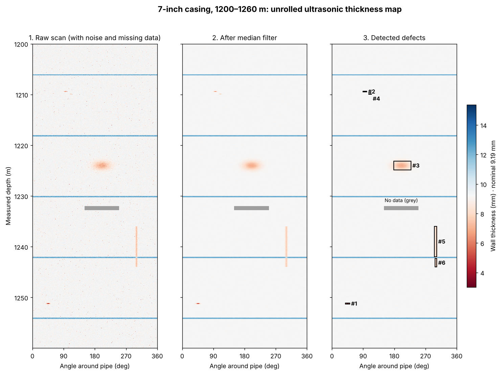
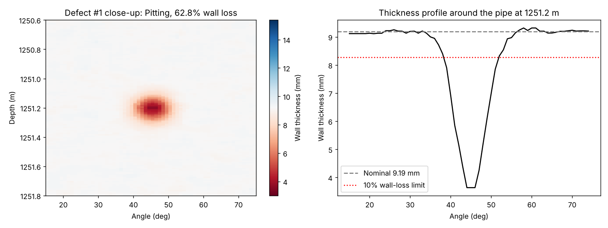

# Pipe Integrity Analysis Toolkit

A small Python project that copies the core workflow of a well-integrity analyst:
take an ultrasonic wall-thickness scan of a well casing, clean it, find defects,
measure and classify them, and present the results as images, a defect table and
an interactive 3D view.

The scan is **simulated** (a 60 m interval of 7-inch casing with planted defects),
so the detection results can be checked against a known answer key.



## What it does

| Step | What happens | Why it matters |
| --- | --- | --- |
| 1. Data quality | Finds intervals with missing readings (no echo, e.g. gas) | No defect calls are made where the data can't support them |
| 2. Clean | 5×5 median filter removes speckle noise | Median keeps defect edges sharp; a mean filter would blur them |
| 3. Normal geometry | Recognises collars (thicker rings every ~12 m) | Collars are not defects and must not be reported |
| 4. Find | Flags readings with more than 10% wall loss | A simple, explainable reporting threshold |
| 5. Group & measure | Joins touching thin readings into defects; measures depth, clock position, length, width, minimum wall and % wall loss | The deepest point is measured on lightly filtered (3×3) data, because heavy filtering makes pits look shallower than they are |
| 6. Classify & rank | Pitting / general corrosion / wear groove; Low → Severe | Puts the most serious findings first |
| 7. QA check | Compares results against the planted defects | Confirms nothing was missed and nothing false was reported |

## Results

All 5 planted defects found, 0 false calls. Measured wall loss is within about 3
percentage points of the true value (for example, a 65% pit measured at 62.8%).

| # | Depth (m) | Clock | Type | Wall loss | Severity |
| --- | --- | --- | --- | --- | --- |
| 1 | 1251.20 | 2 o'clock | Pitting | 62.8% | Severe |
| 2 | 1209.40 | 3 o'clock | Pitting | 41.8% | High |
| 3 | 1224.03 | 7 o'clock | General corrosion | 27.7% | Moderate |
| 4 | 1209.90 | 4 o'clock | Pitting | 26.7% | Moderate |
| 5 | 1237.87 | 10 o'clock | Wear groove | 22.2% | Moderate |
| 6 | 1242.68 | 10 o'clock | Wear groove (same groove, split by a collar) | 21.4% | Moderate |



`outputs/pipe_3d.html` opens an interactive 3D view of the casing, coloured by
wall thickness (radius exaggerated 20× so the pipe is visible).

## What I learned

- **Filtering is a trade-off.** The first version used the same 5×5 filter for
  finding and measuring, and it under-reported a 65% pit as 40%. Separating
  "detect on smooth data" from "measure on detailed data" fixed it.
- **Resolution matters.** At 5 cm spacing, small pits were missed entirely; at
  1 cm they were all found. This is why high-resolution imaging tools are valuable.
- **Context prevents false calls.** Collars, missing data and a groove crossing a
  collar all needed rules based on how a real well is built.

## Run it

**Step-by-step walkthrough (recommended):** open `pipe_integrity_analysis.ipynb` in Jupyter.
It runs each stage separately and shows what it does, with explanations and plots.

**Everything at once:**

```bash
pip install -r requirements.txt
python main.py
```

## Files

- `pipe_integrity_analysis.ipynb` – the walkthrough notebook, with outputs saved
- `simulate.py` – builds the casing scan: noise, collars, missing data and planted defects
- `detect.py` – the analysis workflow and QA check
- `main.py` – runs everything and saves the images, `defects.csv` and the 3D view

Tools: Python, NumPy, SciPy, pandas, Matplotlib, Plotly.
